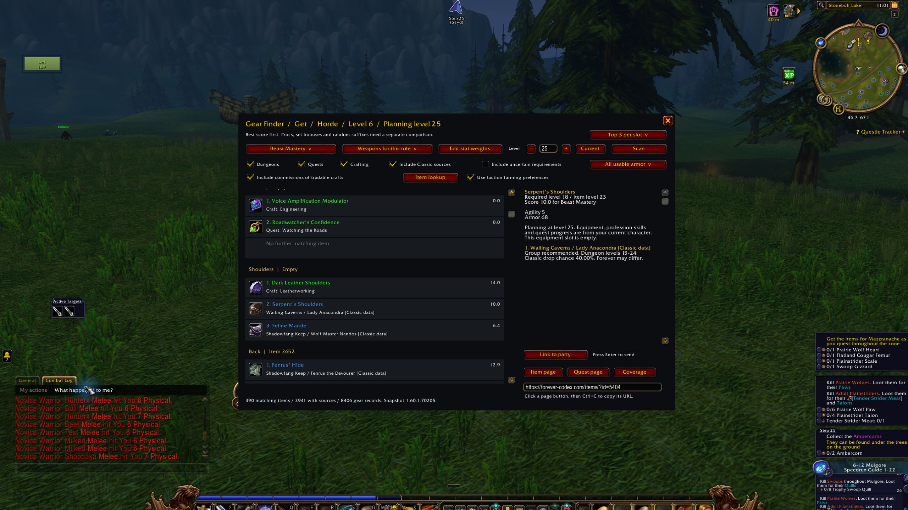

# Gear Finder

Compare gear for your level and role, then find its recorded dungeon, quest or crafting sources.

[Download beta 1.6.3-beta.1](https://github.com/DeanieBobeanie/GearFinder-Forever/releases/tag/v1.6.3-beta.1) · [Report a bug](https://github.com/DeanieBobeanie/GearFinder-Forever/issues) · [Contribute](CONTRIBUTING.md)

For WoW Forever 1.60.1, interface 16001.

## Features

- Rank recorded gear by slot using role-based stat weights.
- Plan upgrades for your current level or a later level.
- Select an item to see its stats, requirements and recorded sources.
- Filter farming options by faction, quest progress and professions.
- Turn faction farming preferences off to include cross-faction dungeon routes. Actual quest faction restrictions still apply.

## Install

1. Download `GearFinder-1.6.3-beta.1.zip` from the [release page](https://github.com/DeanieBobeanie/GearFinder-Forever/releases/tag/v1.6.3-beta.1).
2. Close WoW and extract the ZIP.
3. Copy `GearFinder` into your Forever client's `Interface/AddOns` folder.
4. Restart WoW and enable the add-on at character selection.

The path should end in `Interface/AddOns/GearFinder/GearFinder.toc`. Use the installable ZIP under Assets. GitHub's Source code archives contain the development repository.

To update, replace the add-on folder and keep your WTF folder to retain settings.

## Quick start

Type `/gear`, choose a role and click Scan. Select an item for its source details. Choose a different level to plan ahead.

The Use faction farming preferences checkbox starts enabled. Turn it off to include dungeon routes that the faction preference normally hides.

See the [usage guide](GearFinder/README.md) for filters, custom weights and item lookup.

## Screenshot

Level 25 planning on a level 6 Horde hunter, captured on 21 October 2026. Other installed add-ons are visible around the window.

## Known limits

- The 3 October 2026 data snapshot omits new Forever dungeon drops. See [source coverage](GearFinder/SOURCES.md).
- Rankings use estimated base-stat weights. They do not score procs, set bonuses or complete gear sets.
- Inspect integration still needs an in-game check.

Current-level scans, level 25 planning and item source details were checked in game. Disabling faction farming preferences changed the planning results from 390 to 395 items; enabling it restored 390.

## Help and contributions

[Open an issue](https://github.com/DeanieBobeanie/GearFinder-Forever/issues) with your add-on version, client build, steps to reproduce and the first Lua error. Include the item and source when reporting a data problem. See [CONTRIBUTING.md](CONTRIBUTING.md) for setup and checks.

## Credits and license

Maintained by DeanieBobeanie and contributors. Code uses [GPL-3.0-or-later](LICENSE). Bundled data retains its Classic DB notices. See [data sources](GearFinder/SOURCES.md) and [media credits](media/README.md).
