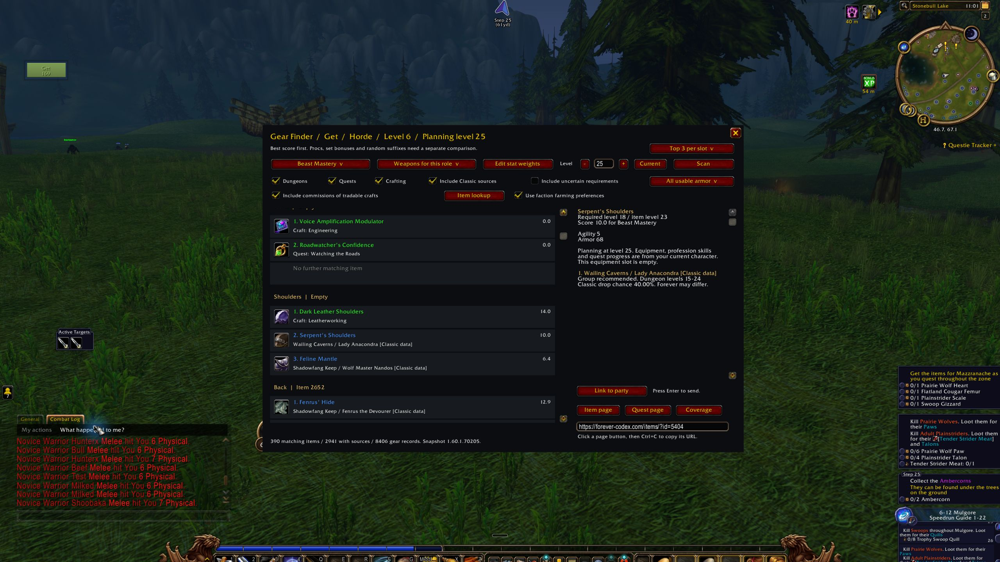

Database refresh for WoW Forever 1.60.1, interface 16001.

## Changes

- Refreshed Forever Codex data on November 7, 2026, using source build 1.60.1.70245.
- Added 122 gear records, bringing the total to 8,528. No existing gear records were removed.
- Increased items with recorded acquisition sources to 2,970, up by 29. The snapshot includes 363 items with dungeon sources, 1,304 with quest sources and 1,317 with crafting sources. Some items have more than one source type.
- Updated the source notices and input hashes.

## Install

Download `GearFinder-1.6.3-beta.2.zip` under Assets. Close WoW, extract it and copy `GearFinder` into your Forever client's `Interface/AddOns` folder. Restart WoW and enable it at character selection.

Type `/gear`, choose a role and click Scan. Keep your WTF folder when updating to retain settings. `SHA256SUMS.txt` contains the download checksum.

## Known limits

- Forever Codex still uses beta build 1.60.1.70245, which predates launch client build 1.60.1.70862. Its data may differ from the current game.
- New Forever dungeon drop tables remain unavailable. Classic sources may differ in Forever.
- Rankings use estimated base-stat weights and omit procs, set bonuses and complete gear-set comparisons.
- This refreshed snapshot has not been tested in-game. Inspect integration still needs an in-game check.

## Checks

The automated Lua 5.1 syntax, data integrity, ranking, filter, faction preference, inspection and UI tests passed. The package contains only the 18 files in the release manifest. All 273 snapshot input hashes verified.

The screenshot below shows the previous beta on October 21, 2026. This update changes data and documentation; the interface is unchanged.

[Usage guide](https://github.com/DeanieBobeanie/GearFinder-Forever#quick-start) · [Report a bug](https://github.com/DeanieBobeanie/GearFinder-Forever/issues) · [Contribute](https://github.com/DeanieBobeanie/GearFinder-Forever/blob/main/CONTRIBUTING.md)
